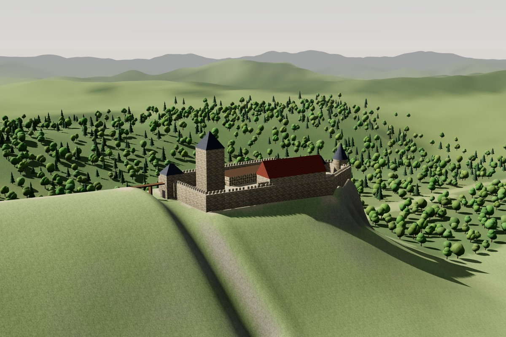
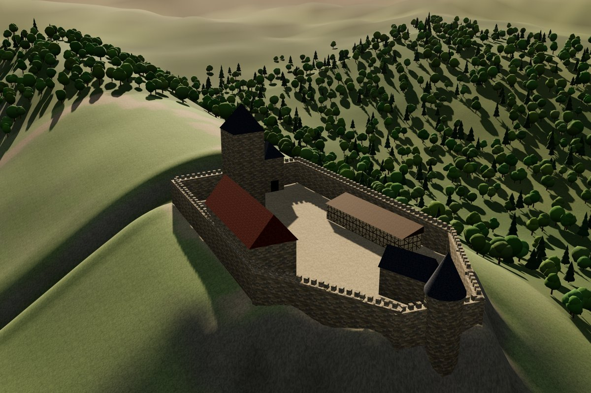

# Burgenmeier

Drei **Claude-Skills**, die zusammen oder einzeln funktionieren:

- **`burgen-recherche`**: Aus einem Burgnamen entsteht ein geprüftes Quellendossier: Lage, Baugeschichte,
  Pläne, historische Ansichten, Schriftquellen und Karten, mit Downloads, Lizenzen und Quellenbewertung.
- **`burgenmeier`**: Aus dem Material entstehen 3D-Modell, Zeichnungen und Befundbericht.
- **`burgenmaler`**: Aus dem Burgenmeister-Modell wird ein verschönertes Schaubild mit Texturen, Licht,
  Himmel und Bewuchs, dazu hochaufgelöste Bilder aus beliebiger Blickrichtung. Die Geometrie bleibt
  unverändert, der Schalter „Befundlage“ auch.

Du kannst eigenes Material hochladen, Claude alles recherchieren lassen oder beides mischen.
Eigenes Material hat Vorrang, die Recherche füllt die Lücken.

Der Skill `burgenmeier` ist ein **Claude-Skill**, der aus Ruinenplänen, alten Illustrationen und Primärquellentexten ein plausibles
**Low-Poly-3D-Modell** einer mittelalterlichen Burg samt ihrer damaligen Umgebung erzeugt. Alternativ
entsteht eine **Zeichnung aus gewählter Perspektive**. Standort, Gelände und historische Umgebung
recherchiert Claude selbst. Jedes Bauteil trägt seine Befundstufe (gesichert / wahrscheinlich / Analogie /
Annahme) und seine Quellen.

| Vogelschau (Federzeichnung) | Grundriss nach Befundlage | Interaktiver 3D-Viewer |
|---|---|---|
|  |  |  |

| Schaubild (Burgenmaler), Blick wie eine Vedute | Schaubild im Abendlicht |
|---|---|
|  |  |

*Abgebildet ist die fiktive „Musterburg“ aus `burgenmeier/examples/`.*

## So funktioniert es

```
Pläne · Bilder · Texte ──► Claude (liest Bilder, wertet Quellen aus, recherchiert per Websuche)
                                   │
                                   ▼
                            castle.json  ◄── strukturierte, belegte Burgbeschreibung
                                   │
           ┌───────────────┬───────┴────────┬──────────────────┐
           ▼               ▼                ▼                  ▼
   build_model.py     draw_view.py     report.py          plan.py overlay
   GLB/OBJ + Viewer   SVG/PNG-Zeichnung  Quellenbericht   Kontrolle auf dem Plan
```

Mit `burgen-recherche` kommt davor noch ein Schritt:

```
„Burg Falkenstein im Harz“ ──► wikidata.py · Websuche · commons.py ──► quellen.json + dossier.md + quellen/*.jpg
                                                                       └─► castle.json-Gerüst ──► burgenmeier
```

Claude übernimmt die Interpretation, die Skripte die Geometrie. Dadurch sind Modell und Zeichnungen
reproduzierbar und konsistent. Ändert man eine Zahl in `castle.json`, ändern sich alle Ausgaben gleich.

## Installation in claude.ai (Pro, Max, Team, Enterprise)

1. ZIPs bauen: `./build_skill.sh` → `dist/burgenmeier.zip`, `dist/burgen-recherche.zip` und `dist/burgenmaler.zip`.
2. In claude.ai unter **Einstellungen → Funktionen** die **Codeausführung / Dateierstellung** aktivieren.
3. Dort unter **Skills** die ZIP-Dateien hochladen und einschalten. Recherche und Burgenmeister funktionieren auch allein, der Burgenmaler braucht den Burgenmeister.
4. *(Optional, empfohlen)* Für echte Höhendaten, OpenStreetMap und Wikimedia braucht die Sandbox
   Netzzugriff. In den Einstellungen zur Codeausführung diese Domains freigeben: `s3.amazonaws.com`,
   `overpass-api.de`, `www.wikidata.org`, `nominatim.openstreetmap.org`, `commons.wikimedia.org` und
   `upload.wikimedia.org`. Ohne Netz funktioniert alles weiterhin, das Gelände wird
   dann aus der Recherche prozedural erzeugt. Claudes eigene **Websuche** sollte ebenfalls an sein.
5. *(Optional)* Ein **Projekt** „Burgenmeier“ anlegen und dort Pläne, Quellen und Fotos als Projektwissen
   ablegen. Dann starten alle Chats mit diesem Material.

Die genaue Bezeichnung der Menüpunkte kann sich ändern. Gesucht sind die Bereiche für Skills und für
Codeausführung.

## Benutzung im Chat

> Rekonstruiere Burg Hohenstein um 1400. Anbei der Grundriss aus dem Inventarband (Maßstab 1:500), eine
> Ansicht von 1630 und der Auszug aus dem Urbar. Ich hätte gern eine Vogelschau von Südwesten und das
> 3D-Modell.

Claude geht dann so vor:

1. Material sichten; den Plan mit einem Pixelraster vermessen.
2. Koordinaten, Gelände und Umgebung recherchieren und auf das Zieldatum zurückprojizieren.
3. `castle.json` schreiben und validieren.
4. Zeichnung, GLB, Viewer und Quellenbericht erzeugen und das Ergebnis selbst kontrollieren.
5. Erklären, was belegt ist und was nicht, und welches Material die Unsicherheit am stärksten senken würde.

Oder ganz ohne eigenes Material:

> Recherchiere alles zu Burg Reußenstein und zeichne sie als Vogelschau im Zustand um 1400.

Dann sucht Claude zuerst die Quellen mit `burgen-recherche`. Es zeigt dir das Dossier mit Funden und
Lücken und fragt bei großen Lücken nach, bevor es modelliert. Mit dem Dossier kannst du auch selbst
weitersuchen, etwa im Archiv.

Danach kann man im Chat nachsteuern, z. B. „Bergfried mit Zinnenkranz statt Helm“, „Ansicht wie auf der
Vedute von 1630“ oder „nur die Burg, ohne Umgebung, als Grundriss“.

## Lokale Nutzung (ohne Claude)

Benötigt Python 3.9+ mit `numpy` und `Pillow`.

```bash
S=burgenmeier/scripts
python $S/validate.py   burgenmeier/examples/beispiel_castle.json
python $S/build_model.py burgenmeier/examples/beispiel_castle.json --glb burg.glb --obj burg.obj --html burg_3d.html
python $S/draw_view.py  burgenmeier/examples/beispiel_castle.json --view vogelschau -o burg.svg --png burg.png
python $S/draw_view.py  burgenmeier/examples/beispiel_castle.json --azimuth 230 --elevation 20 --focus alles --png umgebung.png
python $S/report.py     burgenmeier/examples/beispiel_castle.json -o bericht.md
python $S/geo.py geocode "Burg Eltz"               # Koordinaten
python $S/geo.py terrain meine_burg.json           # echtes Höhenmodell
python $S/geo.py osm meine_burg.json               # heutige Umgebung als Rohmaterial
python $S/plan.py grid plan.png                    # Raster zum Ablesen von Plankoordinaten

R=burgen-recherche/scripts
python $R/dossier.py init "Burg X" -o quellen.json
python $R/wikidata.py "Burg X" --dossier quellen.json
python $R/commons.py search "Burg X Grundriss" --download quellen/ --dossier quellen.json
python $R/dossier.py check quellen.json && python $R/dossier.py render quellen.json -o dossier.md
python $R/dossier.py castle quellen.json -o castle.json    # Gerüst für burgenmeier

M=burgenmaler/scripts
python $M/paint.py burgenmeier/examples/beispiel_castle.json -o burg_schaubild.html
node   $M/render.mjs burg_schaubild.html --out bilder/ --views vogelschau,umgebung \
       --cam "vedute:az=215,el=12,dist=330,fov=32" --licht abend      # braucht Playwright + Chromium
```

Tests: `pip install pytest && python -m pytest tests`

## Aufbau

```
burgen-recherche/         ← Skill 1: Quellenrecherche
  SKILL.md, reference/quellenorte.md
  scripts/                wikidata, commons, dossier
burgenmeier/              ← Skill 2: Rekonstruktion
  SKILL.md                Arbeitsanleitung für Claude
  reference/              Schema, Typologie & Richtmaße, Umgebung, Quellenkritik
  scripts/                castle_lib (Kern), build_model, draw_view, geo, plan, validate, report
  templates/viewer.html   Three.js-Viewer (Szene wird eingebettet)
  examples/               fiktive Beispielburg
burgenmaler/              ← Skill 3: Schaubild
  SKILL.md
  scripts/                paint.py (castle.json → Schaubild-HTML), render.mjs (Bilder per Chromium)
  templates/schaubild.html  Three.js-Schaubild mit prozeduralen Texturen
tests/                    pytest
build_skill.sh            erzeugt dist/*.zip für alle drei Skills
```

## Grenzen

- Die Recherche findet nur, was digital zugänglich ist. Urkundenbücher ohne Digitalisat, Archivbestände und
  moderne Bauforschung (urheberrechtlich geschützt) werden nur nachgewiesen; das Dossier sagt, wo sie liegen.

- Die Modelle sind **plausibel, nicht wahr**. Die Qualität hängt am Quellenmaterial; die Befundfärbung
  zeigt das ehrlich an.
- Höhenmodelle zeigen das **heutige** Gelände, typischerweise in 5–30 m Auflösung. Kleine Felsen,
  verfüllte Gräben und moderne Eingriffe sind nicht korrigiert. Die Grabenelemente übernehmen das teilweise.
- Low-Poly ist Absicht: keine Fenster, kein Bauschmuck, Dächer als einfache Grundformen.
- Bauten bekommen Wände auf ganzer Footprint-Fläche; Innenhöfe in Gebäuden muss man über mehrere Elemente
  modellieren.
